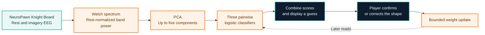

<div align="center">

# ShapeBattle

### Rock-paper-scissors with imagined shapes

ShapeBattle is a browser game built for **NeuroTech 2026 at NC State**. It uses EEG from the NeuroPawn Knight Board to guess whether you imagined a circle, triangle, or square. Confirm or correct the guess to teach the model for later rounds.

[](#project)
[](#project)
[](#responsible-use)
[](LICENSE)
[](#quick-start)
[](#how-it-works)
[](#ai-use-and-attribution)

**[Run locally](#quick-start)** ·
**[See how it works](#how-it-works)** ·
**[Explore the model](#model-at-a-glance)** ·
**[Read the technical guide](docs/neuropawn-imagery.md)**

</div>

> [!IMPORTANT]
> ShapeBattle is a research prototype. Its holdout score measures same-session performance on cued trials. Decoding accuracy on privately chosen shapes needs a separate blind evaluation.

## Project

The team built ShapeBattle for the **NeuroTech 2026 hackathon at NC State**. The player imagines a shape, reviews the decoder's guess, and confirms the shape they intended before playing against a uniformly random computer move.

**Square beats triangle**, **triangle beats circle**, and **circle beats square**. Matching shapes draw. [Browser rules](config.js)

## The idea

Can a decoder trained on one person's cued EEG trials make useful guesses about the shapes that person later chooses in private?

- **Train for the wearer.** Collect 150 cued trials, with 50 prompts per shape.
- **Show the comparisons.** Display the model's guess and its three pairwise scores so the player can see how close the alternatives were.
- **Learn from corrections.** Use the confirmed shape to update the classifier for later reads.
- **Keep recordings local.** The browser saves EEG and feedback in IndexedDB. The player can export the session as JSON.

## How it works



1. **Training.** The browser fits the feature transform and classifiers on the first 120 prompted trials and scores the final 30. It then fits the starting gameplay model on all 150 trials.
2. **Prediction.** A fresh EEG read goes through the same feature transform. The decoder combines three comparisons into one distribution and records its guess before receiving feedback.
3. **Learning.** Confirmed rounds update the classifier weights for later reads. The PCA projection stays fixed to the original training data. [Trial schedule and gameplay](browser-game.js) · [Decoder implementation](browser-decoder.js)

## Model at a glance

The browser samples EEG at **125 Hz** and compares four frequency bands from the imagery window with the same trial's rest window. PCA compresses the standardized features, and logistic regression turns each pairwise margin $m$ into a probability with $\sigma(m)=1/(1+e^{-m})$.

The three pairs are circle vs. square, triangle vs. circle, and square vs. triangle. Confirmed gameplay labels have one-quarter the training weight of a cued label. The website estimates confidence separately using held-out and earlier pre-feedback predictions.

### How the browser decoder works

<details>
<summary>Equations, training objective, and implementation details</summary>

#### 1. Collect a balanced dataset

The Knight Board streams EEG at $f_s=125$ Hz. Each prompted trial records two seconds of rest, displays a one-second shape cue, then records five seconds of imagery after **GO**. The decoder skips the first second after GO, leaving 250 rest samples and 500 analyzed imagery samples per input. Ten shuffled blocks of 15 trials yield **50 examples per shape**. Each block contains five of each shape. [Acquisition code](browser-serial.js) · [Trial schedule and capture](browser-game.js) [^frames]

If one input clips during rest or imagery, the browser records its input number and masks that channel for the entire trial. It requests a retry if a second input clips or if the only active input clips. The browser stores the session in IndexedDB, including the board settings, raw EEG, prompt labels, and gameplay feedback. [Clipping detection](browser-serial.js) · [Session storage](browser-store.js) [^clipping]

#### 2. Convert EEG to rest-normalized Fourier features

For each channel $c$, `logPowers()` divides the signal into one-second windows of $N=125$ samples with a 63-sample hop. For segment $j$, it subtracts the segment mean $\bar x_{c,j}$ and multiplies by the periodic Hann window $w[n]=\tfrac12(1-\cos(2\pi n/N))$. The discrete Fourier coefficient at bin $k$ is

$$
X_{c,j}(k)=\sum_{n=0}^{N-1} w[n]\bigl(x_{c,j}[n]-\bar x_{c,j}\bigr)e^{-2\pi i kn/N}.
$$

Welch's method averages the windowed periodograms, which are proportional to $|X_{c,j}(k)|^2$, to estimate the power spectral density $S_c(k)$. At 1 Hz bin spacing, the four bands sum bins **4–7**, **8–12**, **13–19**, and **20–30 Hz**. For band $B$, define $P_{c,B}=\sum_{k\in B}S_c(k)$. The feature is the log-power difference $f_{c,B}=\log\max(P^{\mathrm{go}}_{c,B},10^{-12})-\log\max(P^{\mathrm{rest}}_{c,B},10^{-12})$. This measures the change from that trial's own rest period and gives four features per selected input. [`logPowers()` and `features()`](browser-decoder.js) [^welch]

#### 3. Standardize and project with PCA

For each feature column $d$, `projector()` learns a mean $\mu_d$ and scale $\sigma_d$ from the training rows, then standardizes each feature as $z_d=(f_d-\mu_d)/\sigma_d$. A clipped channel's missing features contribute zero in standardized space, equivalent to filling them with the training mean. Features with no observed training values contribute zero even if that input returns during play.

The code forms the covariance $C=Z^\top Z/n$ from the $n$ standardized training rows and uses Jacobi rotations to find its eigenvectors. It retains up to five directions of largest variance. The projected scores are $u=V_K^\top z$. Their norm is capped at 3, and a constant 1 is appended for the bias term, giving the classifier input $h$. [`projector()`](browser-decoder.js) [^pca]

#### 4. Train three pairwise logistic classifiers

The three comparisons are **circle vs. square**, **triangle vs. circle**, and **square vs. triangle**. Each sees only the trials labeled with one of its two shapes. For pair $(a,b)$, the model computes a margin $m_{ab}(h)=\theta_{ab}^\top h$ and a pairwise probability $P(a\mid a,b,h)=\sigma(m_{ab}(h))$, where $\sigma(t)=1/(1+e^{-t})$.

`initialWeights()` fits each classifier by momentum gradient descent on weighted logistic loss with an $L_2$ penalty. With example label $y_i=1$ for the first shape in the pair, margin $m_i=\theta^\top h_i$, and example weight $\omega_i$, the objective is

$$
L(\theta)=\sum_i \omega_i\bigl[\log(1+e^{m_i})-y_i m_i\bigr]+\tfrac12\sum_d\lambda_d\theta_d^2.
$$

The browser uses $\lambda_d=1$ for feature coefficients and $\lambda_d=0.25$ for the bias. To combine the comparisons, `couple()` treats the margins as signed log-odds with $m_{ba}=-m_{ab}$. The centered class scores $s_a=\tfrac13\sum_{b\ne a}m_{ab}$ are the least-squares fit to the three pairwise score differences. Softmax converts them to one distribution, $p_a=e^{s_a}/\sum_b e^{s_b}$. The largest $p_a$ determines the guess. [`loss()`, `initialWeights()`, and `couple()`](browser-decoder.js) [^logistic]

#### 5. Evaluate, refit, and learn from feedback

- **Hold out the final blocks.** `validateHoldout()` fits the feature transform and classifiers on blocks 1–8, then scores blocks 9–10. This gives a 120-trial training split and a 30-trial cued holdout. The game fits its starting model on all 150 trials after scoring the holdout. [Training and holdout](browser-game.js) · [Decoder](browser-decoder.js)
- **Update after confirmation.** Each prompt has training weight $1$, and each confirmed gameplay example has weight $0.25$. The PCA projection stays anchored to the initial dataset. `anneal()` searches nearby classifier weights using the original trials and confirmed rounds. For a proposed loss increase $\Delta L$, the acceptance probability is $e^{-\Delta L/T}$ at temperature $T$. Proposals stay within distance $0.12/\sqrt{10}$ of the previous coefficients, and the best candidate found is used for the next read. [`anneal()` and `boundedProposal()`](browser-decoder.js) [^annealing]
- **Calibrate confidence separately.** The browser fits inverse temperature $\alpha=1/T$ on held-out prompted predictions and earlier gameplay predictions saved before their labels were known. The scaling function is $q_a(\alpha)=p_a^\alpha/\sum_b p_b^\alpha$, with a small numerical floor on $p_a$. Prompted reads have confidence-fit weight $0.5$, and confirmed gameplay reads have weight $1$. The displayed distribution mixes $q_a$ with $1/3$ in proportion $\rho=2/(3+0.5n_{\mathrm{hold}}+n_{\mathrm{play}})$ toward uniform confidence. The highest-scoring shape stays the same. [Confidence implementation](browser-confidence.js) [^temperature]
- **Score the original prediction.** The dashboard compares each pre-feedback guess with the player's confirmed label. For shape $a$, precision is $\mathrm{TP}_a/(\mathrm{TP}_a+\mathrm{FP}_a)$ and recall is $\mathrm{TP}_a/(\mathrm{TP}_a+\mathrm{FN}_a)$. Macro averages use only shapes with a defined denominator. Training trials and discarded reads are excluded. [Gameplay metrics](browser-game.js)

</details>

## Quick start

### Prerequisites

- A NeuroPawn Knight Board with electrodes and a USB connection
- Desktop Chrome with Web Serial for direct headset access
- Python 3 for building and serving the static site. The terminal EEG tools use Python 3.11–3.14. [^webserial] [^setup] [^commands]

### 1. Start the website

```sh
git clone https://github.com/PParkkila/ShapeBattle.git
cd ShapeBattle
python3 scripts/build_web.py
python3 -m http.server 8000 --bind 127.0.0.1 --directory web-dist
```

Open [the local website](http://127.0.0.1:8000) in desktop Chrome.

### 2. Connect, train, and play

1. Close any other app using the board's serial port. Under **Board settings**, select your inputs in acquisition order and set the gain. The browser defaults to inputs 1, 2, and 6 at gain 4. Click **Connect NeuroPawn**.
2. Select **Start training**. Rest at **+**, read the shape cue, and picture it at **GO**. The 150 trials advance automatically and take about 20 minutes plus breaks. You can pause after a trial and continue later.
3. After training, start a read and privately choose a shape at **GO**. Confirm or correct the guess before pressing **Battle**. Use **Download session data** to export EEG, labels, and feedback. Reconnect with the same board settings in the same browser to resume.

### Verify without hardware

In a Python environment with the project dependencies installed, generate synthetic signals and run the offline evaluator.

```sh
python -m pip install -r requirements.txt
python -m imagery simulate --task rps --out runs/synthetic.npz
python -m imagery evaluate --session runs/synthetic.npz
```

The simulator injects a known signal to check the software path. The local Python bridge, terminal recording, and saved-dataset import are also available. For static hosting, use the checked-in Vercel build configuration or upload `web-dist/` with Vercel Drop. [Local bridge](docs/local-bridge.md) · [Recording and import](docs/neuropawn-imagery.md#record-a-150-trial-dataset-in-the-terminal) · [Vercel configuration](vercel.json) [^vercel] [^drop]

## What is recorded and what is simulated?

| Layer | Source |
| --- | --- |
| Browser training EEG | Recorded from the connected board. Training labels come from the prompts. |
| Gameplay feedback | Recorded EEG with the shape reported by the player after the guess. |
| Browser holdout | The final 30 cued trials from the same recording session. |
| Terminal simulation | Synthetic signals with a known pattern for software checks. |

Recordings and player profiles stay local. Keep raw EEG and session exports out of Git. The terminal teaching prototype uses a separate adaptation policy, and the flicker-based SSVEP experiment uses its own decoder. [Python teaching and SSVEP protocols](docs/neuropawn-imagery.md) [^coadaptive] [^transfer] [^drawing] [^ssvep]

## Repository map

```text
ShapeBattle/
├── index.html             # Browser interface
├── session-game.js        # Training, gameplay, and prediction dashboard
├── browser-serial.js     # USB EEG acquisition
├── browser-store.js      # IndexedDB session storage and export
├── browser-game.js       # Trial scheduling, training, and feedback
├── browser-decoder.js    # Band power, PCA, and pairwise classifiers
├── browser-confidence.js # Confidence estimates
├── imagery/              # Python recording, evaluation, and local bridge
├── scripts/build_web.py  # Static site build
├── docs/                 # Setup and technical guides
└── LICENSE
```

## AI use and attribution

**Team** · Ishan Hitesh Mistry, Khrystyna Lukecha, Patrik Parkkila, Natalia Bernardo. The team defined the goals, built and wired the hardware, tested the system, and integrated the software.

Claude (Anthropic) assisted with the game dashboard. Codex (OpenAI) assisted with development, prototyping, data collection, and calibration.

## License

ShapeBattle is licensed under the [GNU General Public License v3.0](LICENSE).

## Responsible use

| Limitation | What to try next |
| --- | --- |
| The browser holdout uses prompts from the same recording. Shape cues, eye movements, and trial order can all correlate with the labels. | Run a separate session with neutral cues and privately chosen shapes. Record the intended shape before revealing the guess. Keep a rest-only control and report its score alongside imagery accuracy. |
| Early validation covered one wearer and one recording session. | Record multiple wearers across different days. Hold out entire sessions to test repeatability, and entire wearers to test whether training transfers between people. Report per-wearer results and uncertainty alongside the aggregate. |
| The model uses four band powers per channel and ignores one clipped input per trial. Movement, poor contact, or interference can affect samples even when they stay within the board's range. | Track contact quality and rejection rates per input. Compare electrode subsets and artifact screening on the same held-out trials before changing the decoder. |
| The output is restricted to the three trained shapes. Band powers summarize the analyzed window and discard timing and phase. | Compare the current features against time-resolved band powers or features that use relationships between electrodes. Keep the same holdout and compare against the simpler model before expanding the shape set. |
| The adaptive model uses labels reported after the player sees the guess, and confidence estimates start with relatively little evidence. | Score a frozen model and the adaptive model side by side on the same fresh rounds. Report per-shape recall and compare confidence estimates with observed accuracy as more blind trials accumulate. |

## Documentation

| Guide | Contents |
| --- | --- |
| [NeuroPawn imagery and teaching](docs/neuropawn-imagery.md) | Board setup, trial protocol, evaluation, and teaching |
| [Local Python bridge](docs/local-bridge.md) | Run the website with the local EEG bridge |
| [Browser decoder](browser-decoder.js) | Feature extraction, projection, classifier training, and feedback updates |
| [Offline evaluation](imagery/model.py) | Fourier and SVD comparison, rest controls, and permutation scoring |

[^webserial]: Chrome for Developers. [Read from and write to a serial port](https://developer.chrome.com/docs/capabilities/serial).
[^setup]: NeuroPawn. [Getting Started with the NeuroPawn Kit](https://docs.neuropawn.tech/getting-started/).
[^commands]: NeuroPawn. [Knight Board Command Set](https://docs.neuropawn.tech/knight-board/command-set/).
[^vercel]: Vercel. [Static Configuration with vercel.json](https://vercel.com/docs/project-configuration/vercel-json).
[^drop]: Vercel. [Vercel Drop](https://vercel.com/kb/vercel-drop).
[^frames]: NeuroPawn. [Knight Board Data Format](https://docs.neuropawn.tech/knight-board/data-format/).
[^clipping]: NeuroPawn. [Troubleshooting clipped or flat traces](https://docs.neuropawn.tech/troubleshooting/#trace-is-clipped-flat-at-a-limit-or-unusually-large).
[^welch]: P. D. Welch (1967). [The use of fast Fourier transform for the estimation of power spectra](https://doi.org/10.1109/TAU.1967.1161901). *IEEE Transactions on Audio and Electroacoustics*, 15(2), 70–73.
[^pca]: I. T. Jolliffe and J. Cadima (2016). [Principal component analysis: a review and recent developments](https://doi.org/10.1098/rsta.2015.0202). *Philosophical Transactions of the Royal Society A*, 374, 20150202.
[^logistic]: scikit-learn. [Logistic regression](https://scikit-learn.org/stable/modules/linear_model.html#logistic-regression).
[^annealing]: S. Kirkpatrick, C. D. Gelatt Jr., and M. P. Vecchi (1983). [Optimization by Simulated Annealing](https://doi.org/10.1126/science.220.4598.671). *Science*, 220(4598), 671–680.
[^temperature]: C. Guo, G. Pleiss, Y. Sun, and K. Q. Weinberger (2017). [On Calibration of Modern Neural Networks](https://proceedings.mlr.press/v70/guo17a.html). *Proceedings of ICML*, 1321–1330.
[^coadaptive]: C. Vidaurre, C. Sannelli, K.-R. Müller, and B. Blankertz (2011). [Machine-learning-based coadaptive calibration for brain-computer interfaces](https://pubmed.ncbi.nlm.nih.gov/21162666/). *Neural Computation*, 23(3), 791–816.
[^transfer]: H. He and D. Wu (2020). [Transfer Learning for Brain–Computer Interfaces: A Euclidean Space Data Alignment Approach](https://pubmed.ncbi.nlm.nih.gov/31034407/). *IEEE Transactions on Biomedical Engineering*, 67(2), 399–410.
[^drawing]: G. Wang, Y. Huang, L. Muckli, and D. Faccio (2026). [Symbiotic brain-machine drawing via visual brain-computer interfaces](https://www.nature.com/articles/s44385-026-00086-6). *npj Biomedical Innovations*, 3, 31.
[^ssvep]: NeuroPawn. [SSVEP tutorial](https://docs.neuropawn.tech/tutorials/ssvep/).
